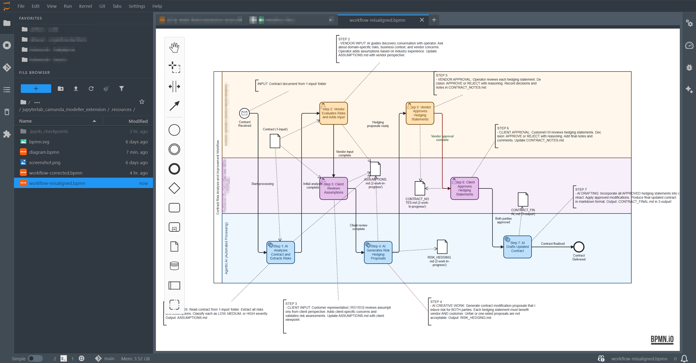

# jupyterlab_camunda_modeller_extension

[](https://github.com/stellarshenson/jupyterlab_camunda_modeller_extension/actions/workflows/build.yml)
[](https://www.npmjs.com/package/jupyterlab_camunda_modeller_extension)
[](https://pypi.org/project/jupyterlab-camunda-modeller-extension/)
[](https://pepy.tech/project/jupyterlab-camunda-modeller-extension)
[](https://jupyterlab.readthedocs.io/en/stable/)
[](https://kolomolo.com)
[](https://www.paypal.com/donate/?hosted_button_id=B4KPBJDLLXTSA)

> [!TIP]
> This extension is part of the [stellars_jupyterlab_extensions](https://github.com/stellarshenson/stellars_jupyterlab_extensions) metapackage. Install all Stellars extensions at once: `pip install stellars_jupyterlab_extensions`

Model BPMN diagrams and open Camunda BPMN files directly in JupyterLab. This extension provides a visual editor for business process modelling within the JupyterLab environment.



## Features

- **BPMN diagram modelling** - Create and edit BPMN 2.0 diagrams visually
- **Camunda BPMN support** - Open and modify Camunda-specific BPMN files
- **JupyterLab integration** - Native file browser integration for .bpmn files
- **Element colouring** - Colour picker in the element context pad
- **Export as SVG** - Download the diagram as an SVG file from the canvas context menu
- **Realign Connectors** - Widen text annotations and redraw their association lines from the canvas context menu
- **Toolbar** - Reload from disk, zoom out, zoom in, fit the diagram to the view, and validate
- **Text editor** - Open With > Editor shows the BPMN XML with syntax highlighting, closing-tag completion and folding
- **Validation** - The toolbar Validate button and the `bpmn-validate` command report malformed XML, broken references, elements the modeller cannot show and common modelling mistakes

## Requirements

- JupyterLab >= 4.6

## Installation

```bash
pip install jupyterlab-camunda-modeller-extension
```

## Validating BPMN files

The package installs the `bpmn-validate` command. It reads the files and never changes them.

```bash
bpmn-validate diagram.bpmn
bpmn-validate --json processes/*.bpmn
```

Each issue prints as `path:line:column: severity code: message`. Errors mean the file is broken; everything else is a warning. The command exits 0 when no file has an error, 1 when a file has an error, and 2 when a file cannot be read. `bpmn-validate --help` lists every check.

In JupyterLab, the Validate button in the diagram toolbar runs the same checks on the diagram as shown, unsaved edits included, and lists each issue with its severity, element and message.

### Agent skill

The skill `.agents/skills/jupyterlab-camunda-modeller-extension/SKILL.md` tells AI coding agents to run `bpmn-validate` after editing a `.bpmn` file. The wheel installs it under `share/jupyter/agents/skills/`. Link it once, with the Python that runs JupyterLab:

```bash
mkdir -p ~/.agents/skills && ln -s "$(python -c 'import sys; print(sys.prefix)')/share/jupyter/agents/skills/jupyterlab-camunda-modeller-extension" ~/.agents/skills/jupyterlab-camunda-modeller-extension
```

From a clone of this repository:

```bash
ln -s "$PWD/.agents/skills/jupyterlab-camunda-modeller-extension" ~/.claude/skills/jupyterlab-camunda-modeller-extension
```

## Uninstall

```bash
pip uninstall jupyterlab_camunda_modeller_extension
```

## Contributing

If you would like to contribute to this extension, please refer to the [Contributing Guide](CONTRIBUTING.md).

---

_Built with the mass irony of using a visual BPMN editor to model workflows that will inevitably be replaced by an AI agent that doesn't need diagrams to understand what you meant. Until then, we'll keep drawing boxes and arrows, pretending that documenting our processes makes them more efficient - when in reality, the diagram will be outdated before the meeting to review it even starts. But hey, at least the boxes are nicely rounded and the gateway diamonds are perfectly centered._
